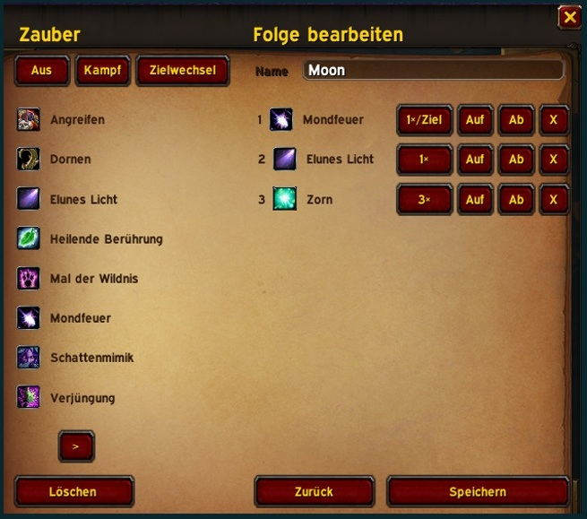
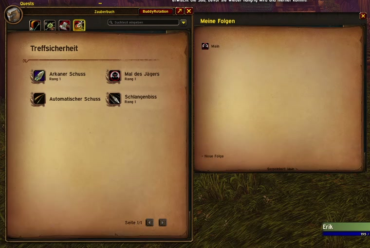

# BuddyRotation

Build your own one-button spell sequences for **World of Warcraft Forever**. Choose spells from your character’s spellbook, arrange them in order, and put the resulting character macro on your action bar. Each press advances the sequence. You choose what to cast.

## Your first sequence

1. Open your spellbook and click **BuddyRotation**, or type `/buddyrotation`.
2. Create a sequence, give it a name and select your spells. Adjust their order and repeat counts. Mark an opener to use once per target if needed.
3. Save the sequence and drag its macro onto your action bar. Press your key for each cast.

Sequences are saved per character. The editor supports English and German. Open it outside combat.

**Already using ForeverBuddy?** The same editor is included. Installing BuddyRotation on its own is enough if the sequence editor is the only feature you want.

[Watch the hunter gameplay test on Twitch](https://www.twitch.tv/videos/2940034482)

[CurseForge](https://www.curseforge.com/wow/addons/buddyrotation) · [Wago](https://addons.wago.io/addons/buddyrotation)
